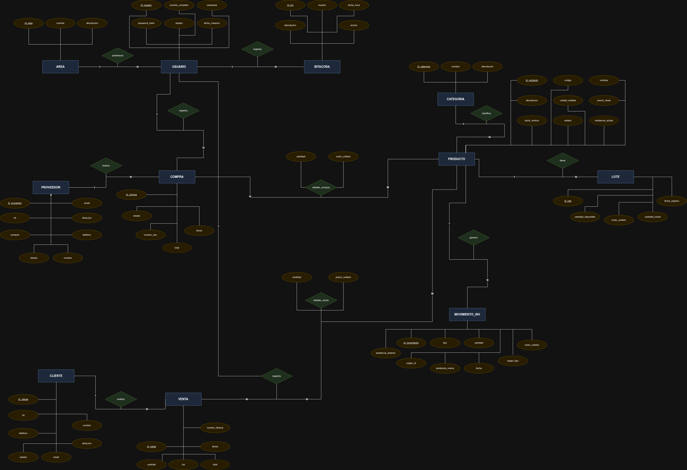
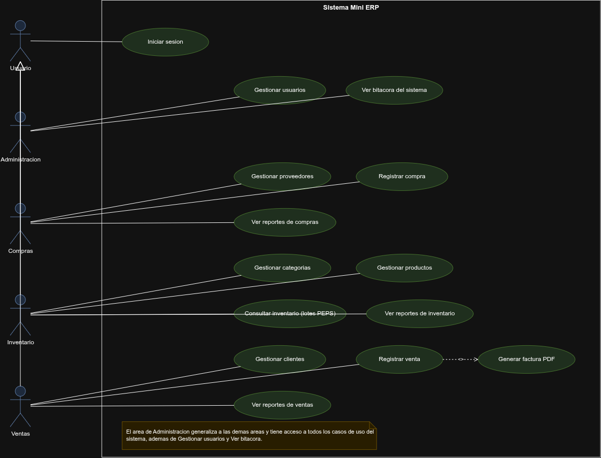
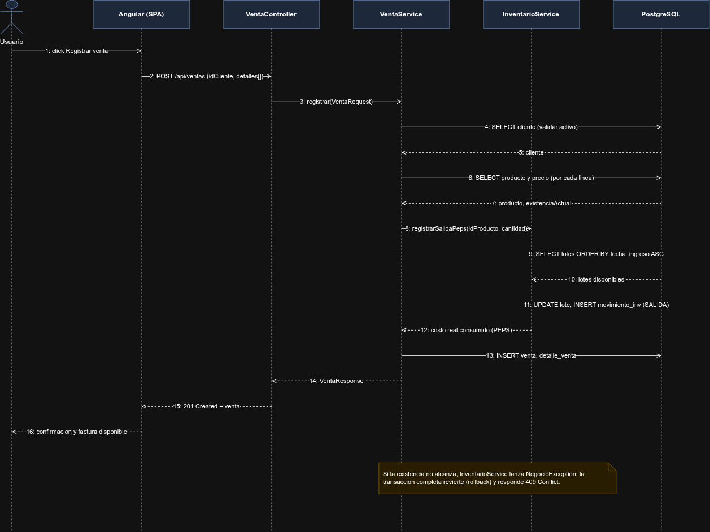
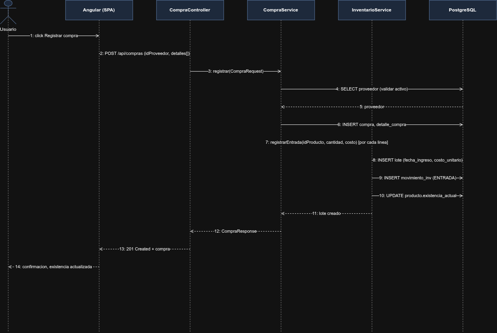
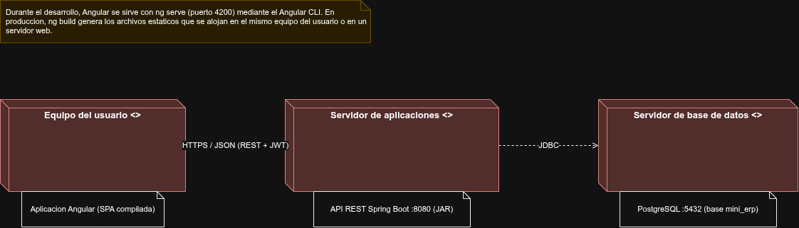

# Mini ERP - Sistema de Gestion Comercial

## Descripcion

Sistema de gestion comercial desarrollado como Proyecto 1 del curso Manejo e Implementacion de Archivos, para una empresa dedicada a la venta y distribucion de muebles para el hogar y la oficina. El sistema integra la administracion de productos, proveedores, compras, inventario, clientes y ventas mediante una arquitectura cliente-servidor.

La aplicacion cliente esta desarrollada en Angular 21 y la aplicacion servidor en Spring Boot con Java 21, comunicandose mediante una API REST. Unicamente el servidor tiene acceso a la base de datos, la cual se administra en PostgreSQL y se crea y carga mediante migraciones con Flyway.

## Caracteristicas

- Arquitectura cliente-servidor con aplicaciones independientes (Angular 21 y Spring Boot)
- Autenticacion mediante JSON Web Tokens (JWT) y contrasenas cifradas con BCrypt
- Control de acceso por roles segun el area del usuario (Administracion, Compras, Inventario, Ventas)
- Control de existencias mediante el metodo PEPS (primeras entradas, primeras salidas), con lotes de costo por cada compra
- Base de datos versionada mediante migraciones SQL con Flyway, sin generacion automatica de tablas
- Transacciones con reversion automatica ante errores, evitando existencias negativas o inconsistentes
- Generacion de facturas de venta en formato PDF
- Modulo de reportes con filtros por fecha, cantidad y agrupacion
- Bitacora de las principales operaciones realizadas por los usuarios
- Borrado logico: el historial de compras, ventas y movimientos se conserva aunque un elemento deje de utilizarse

## Modulos del Sistema

### Modulo de Categorias y Productos
Registro, modificacion y activacion o desactivacion de categorias y productos. La existencia de un producto es un valor derivado que solo cambia mediante compras y ventas, nunca de forma manual.

### Modulo de Proveedores y Compras
Administracion de proveedores y registro de compras. Cada compra crea un lote de inventario con su propio costo y genera un movimiento de entrada por cada producto adquirido.

### Modulo de Clientes y Ventas
Administracion de clientes y registro de ventas. El sistema valida la existencia disponible antes de completar la venta, descuenta el inventario por PEPS y genera la factura correspondiente en PDF.

### Modulo de Inventario
Consulta de existencias, lotes disponibles en orden PEPS e historial de movimientos de cada producto, indicando el origen, la cantidad y el usuario responsable de cada cambio.

### Modulo de Usuarios
Administracion de los usuarios del sistema y del area a la que pertenecen, exclusivo del area de Administracion.

### Modulo de Reportes y Bitacora
Reportes de productos e inventario, compras y proveedores, ventas y clientes, y bitacora de operaciones, cada uno con sus propios filtros de busqueda.

## Requisitos Previos

- **Java JDK:** version 21
- **PostgreSQL:** version 16 o superior
- **Node.js:** version 20.19 o superior (se recomienda la version 22)
- **Angular CLI:** version 21
- **Sistema Operativo:** Windows, Linux o macOS

El backend incluye el wrapper de Maven (`mvnw`), por lo que no es necesario instalar Maven de forma independiente.

### Verificar las versiones instaladas

```bash
java -version
node -v
ng version
```

## Instalacion y Ejecucion

### 1. Clonar el repositorio

```bash
git clone https://github.com/Mynor-M-50/Proyecto_1_Manejo_De_Archivos_Mynor_Monzon_2S_2026.git
cd Proyecto_1_Manejo_De_Archivos_Mynor_Monzon_2S_2026
```

### 2. Crear la base de datos

Unicamente se crea la base vacia; las tablas y la carga inicial las genera Flyway automaticamente al iniciar el servidor.

```bash
sudo -u postgres psql -c "CREATE DATABASE mini_erp;"
```

Si la contrasena del usuario `postgres` es distinta a la configurada, debe actualizarse en `backend/src/main/resources/application.yml`, en la propiedad `spring.datasource.password`.

### 3. Iniciar el servidor (backend)

```bash
cd backend
./mvnw spring-boot:run
```

El servidor queda disponible en `http://localhost:8080` cuando la consola muestra `Started BackendApplication`.

### 4. Iniciar la aplicacion cliente (frontend)

En otra terminal:

```bash
cd frontend
npm install
ng serve
```

### 5. Acceder al sistema

Con ambas aplicaciones en ejecucion, se abre el navegador en `http://localhost:4200`. La carga inicial incluye un usuario por cada area:

| Usuario | Contrasena | Area |
|---|---|---|
| admin | 123456 | Administracion |
| compras | 123456 | Compras |
| inventario | 123456 | Inventario |
| ventas | 123456 | Ventas |

## Estructura del Repositorio

```
Proyecto_1_Manejo_De_Archivos_Mynor_Monzon_2S_2026/
  backend/                      -> Aplicacion servidor (Spring Boot)
    src/main/java/com/minierp/backend/
      config/                   -> Configuracion de seguridad y CORS
      controller/                -> Controladores REST
      dto/                      -> Objetos de transferencia de datos
      entity/                   -> Entidades JPA
      exception/                -> Excepciones y manejo global de errores
      repository/               -> Repositorios Spring Data JPA
      security/                 -> JWT, filtro y detalle de usuario
      service/                  -> Reglas de negocio
    src/main/resources/
      application.yml
      db/migration/             -> Scripts Flyway (V1, V2)
  frontend/                     -> Aplicacion cliente (Angular)
    src/app/
      core/                     -> Modelos, servicios, guards e interceptor
      layout/                   -> Menu lateral y barra superior
      pages/                    -> Una carpeta por pantalla
  docs/                         -> Manuales y diagramas del proyecto
```

## Tecnologias Utilizadas

| Tecnologia | Version | Uso |
|---|---|---|
| Java | 21 | Lenguaje del servidor |
| Spring Boot | 4.1.1 | Framework del servidor y API REST |
| Spring Data JPA / Hibernate | 7.4.5 | Persistencia de datos |
| Flyway | 12.4.0 | Migraciones versionadas de la base de datos |
| PostgreSQL | 16 | Motor de base de datos |
| Spring Security + JWT (jjwt) | 0.12.6 | Autenticacion y autorizacion |
| OpenPDF | 2.0.3 | Generacion de facturas en PDF |
| Lombok | 1.18.42 | Reduccion de codigo repetitivo |
| Apache Maven | - | Construccion del backend |
| Angular | 21 | Framework del cliente |
| TypeScript | - | Lenguaje del cliente |
| Node.js | 22 | Entorno de ejecucion del cliente |
| draw.io | - | Diagrama entidad-relacion y diagramas UML |

## Autor

Mynor Miguel Monzon Martinez - 202230884

Universidad de San Carlos de Guatemala, Centro Universitario de Occidente (CUNOC)

---

## Documentacion

- [Manual de Usuario](docs/ManualDeUsuarioProyecto1Archivos.pdf)
- [Manual Tecnico](docs/ManualTecnicoProyecto1Archivos.pdf)

## Diagrama Entidad-Relacion



## Diagrama de Casos de Uso (UML)



## Diagrama de Secuencia: Registrar una Venta (UML)



## Diagrama de Secuencia: Registrar una Compra (UML)



## Diagrama de Despliegue (UML)

